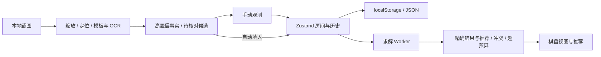

# 技术架构

## 数据流

## 责任边界

`core` 是没有 React、DOM、wx 依赖的纯 TypeScript 模块，包含可序列化模型、约束求解与推荐。迁移到 Vue 或小程序时可复用这层。Board 可通过 structured clone 传到 worker；方案计数内部使用 BigInt，输出合法布局总数为字符串。

`stores/boards.ts` 保存房间、activeId、最多 80 步全量快照历史。编辑生成新数组，不污染历史。恢复与导入都经过 schema 验证；无效导入不会覆盖现存房间。空房间集是合法状态。存储失败时应用保留内存状态并提示导出，历史不跨刷新。

`hooks/useSolver.ts` 在每次房间事实变更后启动任务。替换或卸载时终止旧 worker，旧任务不能覆盖最新棋盘。5 秒/200 万节点是核心枚举预算，12 秒是外层兜底超时；页面可继续编辑或取消。无法启动 worker 时显示明确错误，不以主线程重计算掩盖受限环境。

`features/image-recognition` 的像素纯函数独立可测。主线程仅解码缩放、生成字体模板；自动定位与逐格识别在 image worker 中运行。数字 OCR 自带 worker，所有脚本/WASM/模型均从同源路径加载。缺少 OffscreenCanvas 时，使用主线程 Canvas、逐格让出事件循环和独立 OCR worker。

`ImageImporter` 管理自动识别进度、取消与多图队列。`automatic.ts` 负责解码、定位、模板/OCR调用及置信度门槛，高置信度直接进入新房间；弱候选存为 Cell.recognition，真实 observed 保持 unknown，不参与求解。用户在主棋盘点击宝石或数字确认后清除候选元数据。非棋盘图片拒绝导入；失败/取消保留原有数据和已成功导入的房间。桌面直接文件选择，手机使用 `ImageSourcePicker` 相册/拍照入口。

`adapters/environment.ts` 检测微信 UA、触摸、worker 和剪贴板等能力，保留独立 HostAdapter 注入点。能力检测只是特征提示，不是宿主权限保证。核心模块无 wx 全局依赖。

## 布局与可访问性

桌面三栏，平板两栏，手机单列与底部操作。格子至少 44×44px，棋盘内部横向滚动，页面本身无横向溢出。格子使用原生模态 dialog，只包含宝石和 0–8，选择即关闭；旗标与擦除在棋盘工具栏。原生 dialog 管理编辑、图片来源和识别流程的焦点与 Escape。

数字、◆、×、✓、⚑、文字标签与颜色共同表达状态。提供浅深主题、键盘焦点、reduced-motion 和安全区域。未知概率与确定 0/1 分离显示；所有概率四舍五入显示整数，确定结果样式仍只由严格 0/1 决定。图例覆盖用户指定的全部 8 类。

## 静态部署与性能

前端主包、求解 worker、图像 worker 分别打包；OCR 资源只在数字模板不确定时按需加载。public OCR 分发资源约 60MB，但浏览器只选择兼容的一个核心和一个语言模型，不会下载整个目录。最多 20 张待处理图片，逐张解码，工作图最大边 1600px；输入限制 30MB 和 2000 万像素，PNG/JPEG 先检查头部尺寸。

不保存原图到 localStorage，不使用跨域 Cookie，不发送图片到网络。OCR 模型读取是同源静态 GET；没有图片上传请求。
