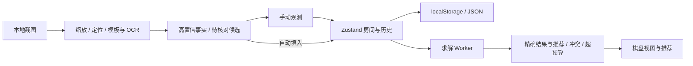

# 技术架构

## 数据流

## 责任边界

`core` 是没有 React、DOM、wx 依赖的纯 TypeScript 模块，包含可序列化模型、约束求解与推荐。迁移到 Vue 或小程序时可复用这层。Board 可通过 structured clone 传到 worker；方案计数内部使用 BigInt，输出合法布局总数为字符串。

`stores/boards.ts` 保存房间、activeId、最多 80 步全量快照历史。编辑生成新数组，不污染历史。恢复与导入都经过 schema 验证；无效导入不会覆盖现存房间。空房间集是合法状态。存储失败时应用保留内存状态并提示导出，历史不跨刷新。

`hooks/useSolver.ts` 在每次房间事实变更后启动任务。替换或卸载时终止旧 worker，旧任务不能覆盖最新棋盘。5 秒/200 万节点是核心枚举预算，12 秒是外层兜底超时；页面可继续编辑或取消。无法启动 worker 时显示明确错误，不以主线程重计算掩盖受限环境。

`features/image-recognition` 的像素纯函数独立可测。`gameBoard.ts` 负责真实游戏皮肤外框/间隙定位、曝光归一化和金色宝石/蓝色盖板/白色数字分类；`glyph.ts` 管理通用与一像素轮廓容差匹配，`gameDigitTemplates.ts` 只包含校准字形掩码。`GridDetection.profile` 将游戏通路传至识别 worker，其他图片继续使用通用投影。主线程仅解码缩放、生成字体模板；自动定位与逐格识别在 image worker 中运行。数字 OCR 自带 worker，所有脚本/WASM/模型均从同源路径加载。缺少 OffscreenCanvas 时，使用主线程 Canvas、逐格让出事件循环和独立 OCR worker。

`ImageImporter` 管理自动识别进度、取消与多图队列。`automatic.ts` 负责解码、定位、模板/OCR调用及置信度门槛，高置信度直接进入新房间；弱候选存为 Cell.recognition，真实 observed 保持 unknown，不参与求解。用户在主棋盘点击宝石或数字确认后清除候选元数据。非棋盘图片拒绝导入；失败/取消保留原有数据和已成功导入的房间。桌面直接文件选择，手机使用 `ImageSourcePicker` 相册/拍照入口。

`adapters/environment.ts` 检测微信 UA、触摸、worker 和剪贴板等能力，保留独立 HostAdapter 注入点。能力检测只是特征提示，不是宿主权限保证。核心模块无 wx 全局依赖。

`features/sharing/links.ts` 是纯数据快照编解码：版本、尺寸、总宝石、房间号、每格观察与旗标通过 UTF-8/base64url 写入 URL fragment，不包含截图、候选或概率缓存。所有输入复用模型验证；内容指纹作为稳定房间 ID。`useSharedBoard` 监听加载和 hashchange，以独立房间恢复，不覆盖已有房间，重复打开同一份快照选中已有副本并保留后续编辑。

`adapters/sharing.ts` 提供宿主注入、系统分享、剪贴板和手动复制回退，取消分享单独返回。`wechatSharing.ts` 接受已加载的官方 SDK 和服务端签名，仅设置微信菜单资料；业务代码不直接依赖 wx。链接默认取当前部署地址，可用 VITE_PUBLIC_APP_URL 覆盖。更多边界见 SHARING.md。

## 布局与可访问性

桌面三栏，平板两栏，手机单列与底部操作。`useBoardLayout` 用 ResizeObserver 观察实际容器宽度，不支持时监听 window resize；`utils/boardLayout.ts` 统一计算坐标轴、间距、格子和字体尺寸。所有列完整显示，无棋盘内部滚动条或页面横向溢出，页面正常纵向滚动。桌面格子最大 52px，窄屏按用户要求缩小，编辑面板按钮保持至少 44px。

格子使用原生模态 dialog，提供宝石、0–8 和“重置此格”，选择即关闭；重置恢复 unknown 并清除旗标/候选，复用既有历史、保存、重新求解。旗标与擦除在棋盘工具栏。原生 dialog 管理编辑、图片来源、识别和分享流程的焦点与 Escape。

数字、◆、×、✓、⚑、文字标签与颜色共同表达状态。提供浅深主题、键盘焦点、reduced-motion 和安全区域。未知概率与确定 0/1 分离显示；所有概率四舍五入显示整数，确定结果样式仍只由严格 0/1 决定。图例覆盖用户指定的全部 8 类。

## 静态部署与性能

前端主包、求解 worker、图像 worker 分别打包；OCR 资源只在数字模板不确定时按需加载。public OCR 分发资源约 60MB，但浏览器只选择兼容的一个核心和一个语言模型，不会下载整个目录。最多 20 张待处理图片，逐张解码，工作图最大边 1600px；输入限制 30MB 和 2000 万像素，PNG/JPEG 先检查头部尺寸。

不保存原图到 localStorage，不使用跨域 Cookie，不发送图片到网络。OCR 模型读取是同源静态 GET；没有图片上传请求。

## 战绩和匿名统计（2026-10-14）

Board.roundId 将一局与可复用的房间区分。`features/battle/stats.ts` 是纯计算/校验模块；最终记录与棋盘分别保存，结束本局按 roundId upsert，整盘重置产生新 roundId。v2 JSON 包含 boards/activeId/records，最多 1000 条最终记录。自动存储键 `tidemyst-boards-v2`，首次读取并迁移 v1；原 v1 键保留供回滚，不再持续同步。

`links.ts` 单独编码 #battle 只读摘要，不与原 #progress 的导入路径混用。`poster.ts` Canvas 生成 1080×1440 PNG，qrcode 生成真实二维码；字体随 npm 打包，无远程图片生成服务。UI 路由监听 hash，只读页不写棋盘；图片分享由独立 adapter 提供取消与下载降级。

CommunityStats 仅在可见页面发送匿名心跳。匿名浏览器 ID 保存在 localStorage，多标签复用；30 秒心跳、90 秒过期，关闭/隐藏后自然离线。`communityStats.ts` 维护有限的离线完成队列，收到服务确认才移除。Node 内置 SQLite 服务只接收 clientId/roundId，数据库存两者联合 SHA-256 和完成时间，不保存截图、棋盘、昵称或战绩比例。唯一键保证重试和重新结算不增加局数。线上 systemd 常驻，Nginx 同源代理；普通静态站无服务时显示不可用并保持本地功能。
